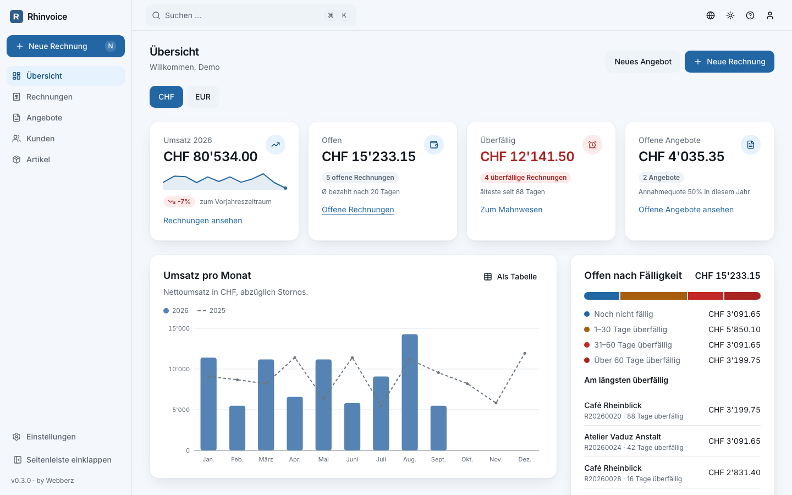
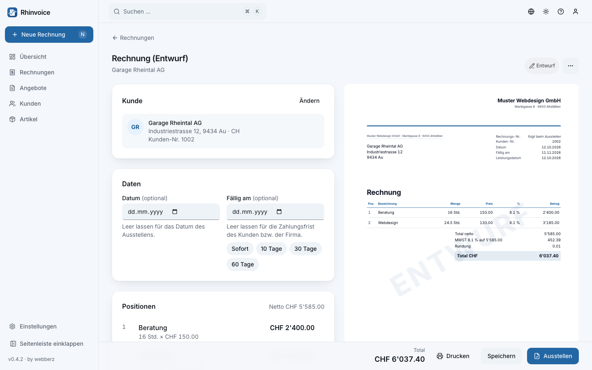
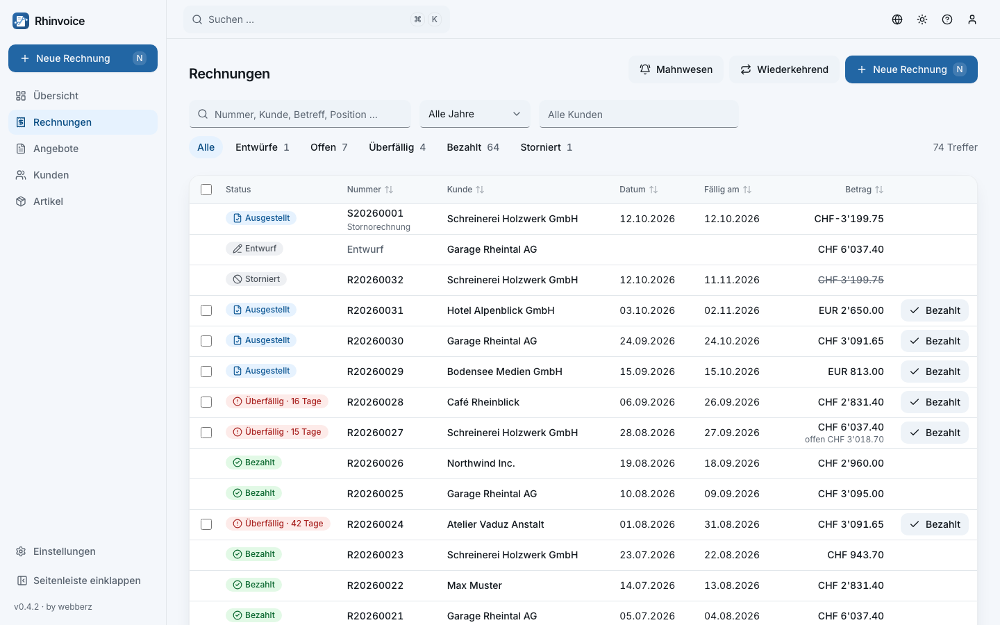
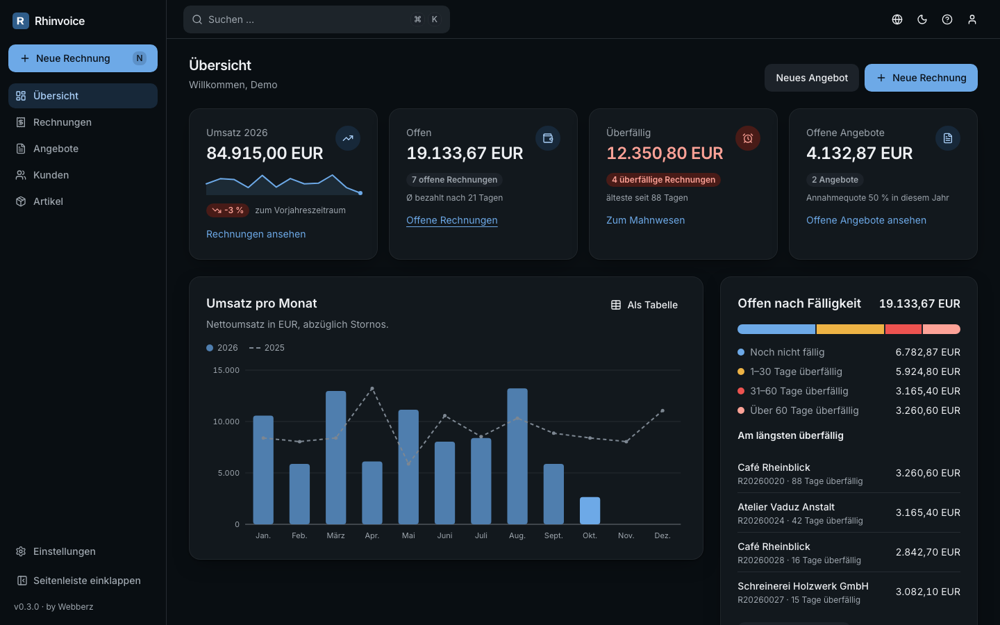
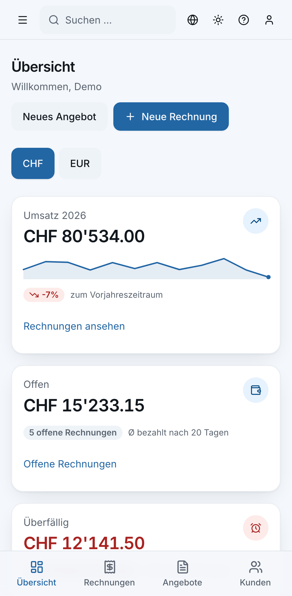

# Rhinvoice

**Open-source invoicing for small businesses in Switzerland, Liechtenstein, Germany and Austria.**
Quotes, invoices, reminders and e-invoices with a calm, keyboard-first interface. Self-hosted with
Docker: your data stays on your server.

> Rhein + Invoice: the Rhine connects CH, FL, AT and DE.

Rhinvoice is in beta (0.x). Try it on a test installation before you write real invoices with it.



<table>
  <tr>
    <td width="50%"></td>
    <td width="50%"></td>
  </tr>
  <tr>
    <td></td>
    <td align="center"></td>
  </tr>
</table>

## Features

**Documents**
- Quotes, invoices and cancellation invoices; turn a quote into an invoice, duplicate, cancel
- Editor with a live paper preview, line and document discounts, net or gross prices
- Numbers assigned when issuing, without gaps; issued documents are immutable, also in the
  database (GoBD, OR 958f, BAO), the PDF is kept with its SHA-256
- Partial payments, open and overdue amounts, full-text search and saved views
- Payment reminders in three levels with new deadlines, fees and texts per language
- Recurring invoices every month, quarter, half-year or year: as a draft, issued, or issued and
  sent by e-mail
- Sending by e-mail through your own mail server, with the PDF and optionally the XRechnung

**Taxes and countries**
- Dated VAT rates for CH, FL, DE and AT; the rate of the service date applies
- Tax treatment decided automatically: domestic, reverse charge, intra-Community supply of goods,
  export, small business, exempt; a manual override is logged
- Goods and services kept apart, also on mixed invoices, each with its legal notice
- Mandatory invoice details checked before issuing
- Swiss 5-cent rounding, number formats and wording per country (MWST / USt, «Jänner», ss / ß)

**Payment and e-invoices**
- Swiss QR-bill with QR or creditor reference (CH, FL)
- EPC QR code / GiroCode (DE, AT, and for euro invoices into the EEA)
- ZUGFeRD / Factur-X (EN 16931) embedded in every PDF, XRechnung 3.0 for German authorities;
  validated with the KoSIT validator and Mustang
- PDF/A-3b output, three print templates with logo, font and footer, own themes possible

**Everyday work**
- Customers and articles with archive and document history
- Import from CSV, XLSX and XLS with column mapping, test run and saved templates
- Dashboard: revenue against last year, open and overdue amounts, open quotes, best customers,
  expected payments
- Command palette (⌘K / Ctrl+K), keyboard shortcuts, light and dark mode
- German (CH, DE, AT) and English; usable on the phone

**Operations**
- Encrypted, deduplicated backups with restic: daily and after issuing, to S3, SFTP, a folder,
  Dropbox, Google Drive and others; tested restore
- Login with optional two-factor authentication
- First-start wizard and a setup checklist
- Images for `linux/amd64` and `linux/arm64` (also Raspberry Pi 4/5)

## Countries

| | Switzerland | Liechtenstein | Germany | Austria |
|---|---|---|---|---|
| VAT rates | 8.1 / 2.6 / 3.8 % | 8.1 / 2.6 / 3.8 % | 19 / 7 % | 20 / 10 / 13 % |
| Small business | not VAT-registered | not VAT-registered | § 19 UStG | § 6 Abs. 1 Z 27 UStG |
| Payment code | Swiss QR-bill | Swiss QR-bill | EPC QR code | EPC QR code |
| Rounding | 0.05 (optional) | 0.05 (optional) | 0.01 | 0.01 |
| E-invoice | ZUGFeRD / Factur-X | ZUGFeRD / Factur-X | ZUGFeRD, XRechnung | ZUGFeRD / Factur-X |

## Quickstart (Docker)

Run the published image, no source code needed: on a server, a NAS, a Raspberry Pi or your own
laptop with Docker Desktop (macOS, Windows, Linux).

```bash
mkdir rhinvoice && cd rhinvoice
curl -fsSLO https://raw.githubusercontent.com/rhinvoice/rhinvoice/v0.4.2/deploy/compose.yml
curl -fsSL https://raw.githubusercontent.com/rhinvoice/rhinvoice/v0.4.2/.env.example -o .env
# edit .env: POSTGRES_PASSWORD and RHINVOICE_VERSION=0.4.2
docker compose pull
docker compose up -d
```

Open <http://rhinvoice.localhost:8000> (no hosts entry needed: `.localhost` is always your own
computer); the first visit offers a one-time setup form for the first user.
To look around with sample data first: `docker compose exec app rhinvoice demo`.

Server setup, e-mail, updates and security: [`docs/install.md`](docs/install.md).
Backups: [`docs/backup.md`](docs/backup.md). Changes: [`CHANGELOG.md`](CHANGELOG.md).

## How Rhinvoice is built

Rhinvoice is developed with heavy AI assistance, directed and reviewed by its maintainer. Because
invoices are legal documents, every change has to pass the strict gate below: 100 % test coverage,
mutation testing, type checks, architecture rules, accessibility checks and the official e-invoice
validators. Tax rules name their official source in the code.

## Quality

Rhinvoice handles money and legal documents, so every change passes a strict gate (`make qa`,
also in CI):

| Area | Tools |
|---|---|
| Backend | ruff (ALL), mypy --strict, pyright strict, import-linter, pytest with 100 % line and branch coverage, hypothesis, real PostgreSQL, schemathesis, mutmut (≥ 90 %), pip-audit |
| Frontend | TypeScript strict, ESLint strict type-checked with jsx-a11y, dependency-cruiser, Vitest with 100 % coverage, pnpm audit |
| E2E | Playwright against the production image, axe-core (WCAG 2.2 AA) in every test, screenshots light/dark × desktop/mobile |
| E-invoices | KoSIT validator and Mustang on every sample |

## Free, and staying that way

Rhinvoice is free to use, change and share under the AGPL, and there are no plans to turn it
into a paid hosted service. If you would like a hosted Rhinvoice, say so in the
[GitHub discussions](https://github.com/rhinvoice/rhinvoice/discussions): if enough sponsors come
together to carry the running costs, it is conceivable.

Interested in a commercial licence, a partnership or taking over the project? Write to us at
hello@rhinvoice.com.

## Contributing

Bug reports, tax rules with their source and pull requests are welcome; see
[CONTRIBUTING.md](CONTRIBUTING.md). Want Rhinvoice for another country? See
[adding a country](docs/adding-a-country.md). Report security issues privately: [SECURITY.md](SECURITY.md).

## No tax advice

Rhinvoice helps you write correct invoices, but it gives no tax or legal advice. Tax rates and
rules are checked against official sources and provided without warranty. Ask your tax adviser
when in doubt.

## License

[GNU Affero General Public License v3.0 or later](LICENSE). You may use, change and share
Rhinvoice freely; if you offer a changed version as a service to others, you share your changes
under the same licence.

made by [webberz](https://www.webberz.ch) in the Swiss Rhine Valley.
